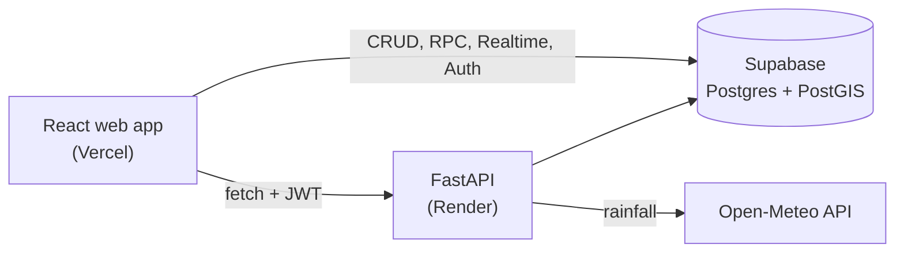

# ResilioMesh

Flood risk prediction and relief coordination for Dhaka.

**Live app:** [resiliomesh.vercel.app](https://resiliomesh.vercel.app) · **API docs:** [resiliomesh.onrender.com/docs](https://resiliomesh.onrender.com/docs)

Track: World Problem Solver · Declared advanced challenges: **A02** Intelligent Decisions & Optimization, **A05** Concurrency & Transaction Management

## The problem

Dhaka's low-lying wards flood within hours of heavy rain. Nobody can tell which drain will fail next. Reports from citizens, the city and NGOs are scattered and duplicated. A few pumps, crews and relief kits go to whoever calls loudest instead of to the places at highest risk.

**Who it is for:** citizens, city Water Resilience Officers, NGO coordinators, field workers and system administrators.

## What it does

Three connected modules share the same incidents, plans and tasks:

1. **Risk prediction:** live Open-Meteo rainfall, drainage condition, history and nearby reports feed an XGBoost model. A rule engine sits on top, and SHAP explains every score.
2. **Resource allocation:** organisation inventories, community needs with duplicate-aid detection, and an OR-Tools CP-SAT optimiser that allocates pumps, crews and relief kits.
3. **Dispatch:** approving a plan starts a 5-step workflow (validate, reserve stock, create tasks, notify, activate) with retries and compensation. Field workers complete their tasks, offline if needed.

**Main workflow:** a citizen reports flooding → an officer verifies it → the AI scores the risk → the optimiser builds a plan → the officer approves → tasks are dispatched → the field worker completes them → the incident is resolved.

## Test access

Open [resiliomesh.vercel.app/login](https://resiliomesh.vercel.app/login), pick a role tab and click a profile under **Demo accounts for judges**. No password is needed.

The API runs on Render's free tier. After a quiet period, the first request can take about 50 seconds.

## Advanced challenges

### A02: Intelligent Decisions & Optimization

* XGBoost risk score with SHAP explanations, plus policy rules the model can never override (for example, water depth ≥ 45 cm is always at least HIGH).
* CP-SAT optimiser ([optimizer.py](backend/app/services/optimizer.py)) with hard constraints: stock limits, strategic reserve, maximum distance, a pump needs a crew, and full coverage of CRITICAL incidents.

**Test: conflicting constraints or an infeasible request**

| Situation | Result |
|---|---|
| Contradictory constraints (e.g. 100% reserve, 0 km distance) | Rejected with `INVALID_CONSTRAINTS` before the solver runs, listing each contradiction |
| Valid but impossible (not enough pumps for every CRITICAL incident) | `INFEASIBLE` with a per-incident and per-resource shortage report |
| Same, with "return best-effort plan" ticked | A partial plan, clearly flagged, that an officer must still approve |

Try it: sign in as a Water Resilience Officer → **Resources** → select assessed incidents → set *Strategic reserve* to `1` → **Run optimiser**.

### A05: Concurrency & Transaction Management

* `rm_reserve_resource` ([004_rpc.sql](supabase/migrations/004_rpc.sql)) locks the stock row with `SELECT … FOR UPDATE` and re-checks the idempotency key after taking the lock. A `CHECK (quantity_available >= 0)` constraint is the last line of defence.
* Reservations, plan approval, optimiser requests and citizen reports all carry idempotency keys, so a double click or retry never acts twice.
* The job queue lives in Postgres and uses `FOR UPDATE SKIP LOCKED`, so two workers never take the same job.

**Test: multiple users request the final available resource**

| Scenario ([test_db_integration.py](backend/tests/test_db_integration.py)) | Result |
|---|---|
| 25 concurrent requests for the last unit | 1 succeeds, 24 get `INSUFFICIENT_STOCK`, stock ends at 0 |
| 10 concurrent requests with the same idempotency key | One allocation, returned to all 10 |

Try it: sign in as the NGO Coordinator in one window and the Admin in a private window. Bring an item down to 1 unit, then allocate it from both windows at the same time.

How each mandatory requirement (M01–M08) is met, with links to code and tests: [docs/REQUIREMENTS_MATRIX.md](docs/REQUIREMENTS_MATRIX.md).

## Architecture



* **Frontend** (React, Vercel): all pages, maps and dashboards. It reads and writes data through Supabase, with row-level security deciding what each user can see and change.
* **Backend** (FastAPI, Render): the risk model, the optimiser, the dispatch workflow worker and CSV import.
* **Database** (Supabase Postgres + PostGIS): the state machine, stock limits, role checks and audit log are triggers and functions in the database, so every path gets the same checks.

## Dependencies

| Part | Main dependencies | Full list |
|---|---|---|
| Frontend | React 19, Vite, Tailwind CSS, React Router, Leaflet, Recharts, supabase-js, idb | [frontend/package.json](frontend/package.json) |
| Backend | Python 3.12, FastAPI, psycopg 3, pandas, XGBoost, OR-Tools, httpx | [backend/requirements.txt](backend/requirements.txt) |
| Services | Supabase (database, auth, realtime), Open-Meteo (weather, no key needed) | |

## Setup

**Prerequisites:** Node.js 22, Python 3.12 and a Supabase project.

```bash
# 1. Database: follow docs/SUPABASE_SETUP.md
#    (run migrations 001–025 and seed.sql, then create the demo users)

# 2. Backend
cd backend
python -m venv .venv
.venv\Scripts\activate                 # macOS/Linux: source .venv/bin/activate
pip install -r requirements.txt
copy .env.example .env                 # macOS/Linux: cp .env.example .env
python -m app.ml.train                 # trains the risk model (~5 s)
uvicorn app.main:app --reload --port 8000

# 3. Frontend (in a second terminal)
cd frontend
npm install
copy .env.example .env
npm run dev                            # http://localhost:5173
```

## Configuration

Copy each `.env.example` to `.env` and fill in the values. `.env` files are git-ignored, and no passwords, tokens or API keys are committed.

| Variable | Where | Purpose |
|---|---|---|
| `SUPABASE_URL`, `DATABASE_URL`, `SUPABASE_SERVICE_ROLE_KEY` | backend | Database connection |
| `CORS_ORIGINS` | backend | Website addresses allowed to call the API |
| `DEMO_MODE`, `DEMO_PASSWORD` | backend | One-click demo sign-in (the password never reaches the browser) |
| `NOTIFY_EMAIL_PROVIDER`, `NOTIFY_SMS_PROVIDER` | backend | `log` by default; set a provider to send real e-mail or SMS |
| `VITE_SUPABASE_URL`, `VITE_SUPABASE_ANON_KEY` | frontend | Public Supabase project details |
| `VITE_API_URL` | frontend | Address of the backend API |

Deployment steps for Render and Vercel: [docs/API_SETUP.md](docs/API_SETUP.md).

## Tests

```bash
cd backend && pytest          # backend unit tests
cd frontend && npm test       # frontend unit tests
cd frontend && npx playwright test   # end-to-end tests
```

Real-database tests and CI details: [docs/TESTING.md](docs/TESTING.md).

## Limitations

* **Training data is synthetic.** No open, labelled ward-level waterlogging dataset exists for Dhaka, so it is simulated from monthly climatology. Replace the CSV in `data/` and run `python -m app.ml.train` to use real data.
* **E-mail and SMS alerts are not switched on** in the live deployment. The sending code exists, but messages are only logged. In-app notifications work.
* **Ward data is approximate.** Ward centres, drainage capacity and elevation are modelled for the demo, and organisation names are fictional.
* **Weather is grid-level** (about 1–11 km), not street-level.
* **Free-tier hosting** sleeps after inactivity, so the first request can be slow.
