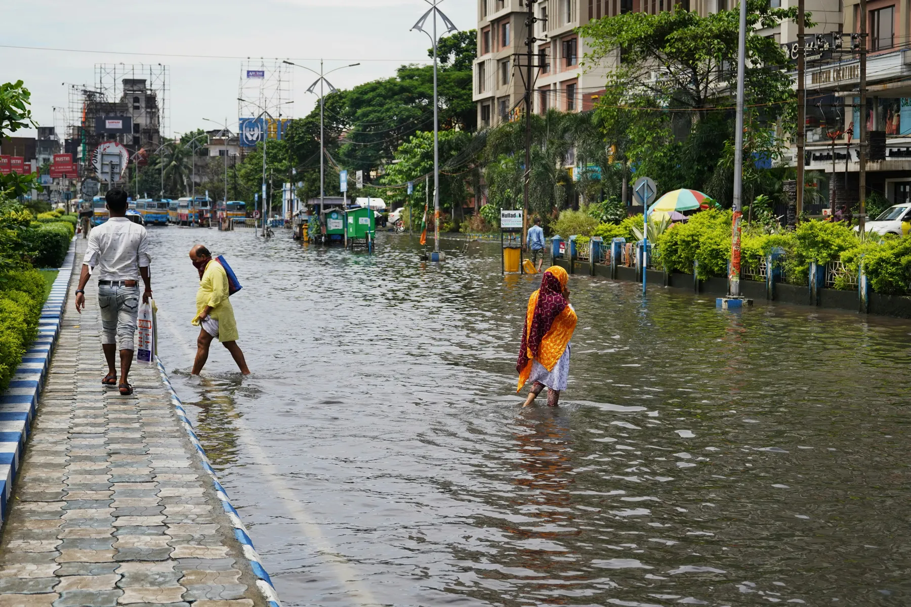
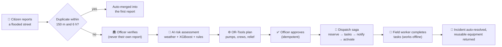
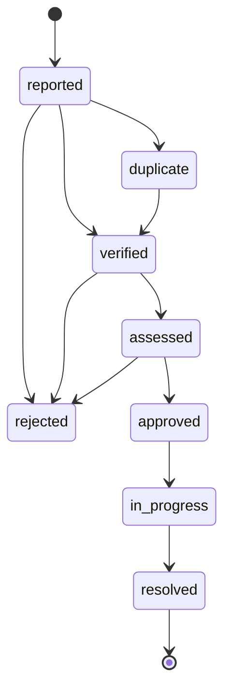
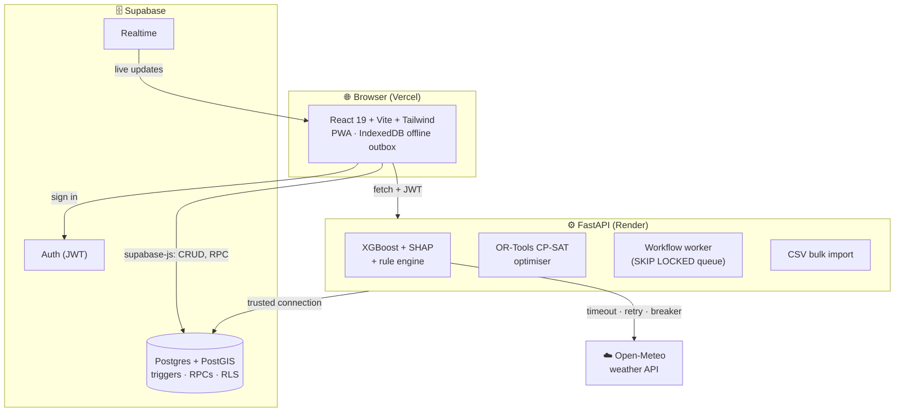

<div align="center">

# 🌊 ResilioMesh

### Flood risk prediction and relief coordination for Dhaka

*Predict risk · Optimise resources · Coordinate response*

[](https://resiliomesh.vercel.app)
[](https://resiliomesh.onrender.com/docs)




</div>

## 📋 Submission summary

| Field | Value |
|---|---|
| **Project title** | ResilioMesh |
| **Selected track** | **World Problem Solver** |
| **Problem statement** | Every monsoon, Dhaka's low-lying wards flood within hours. Nobody can tell which drain will fail next, reports from citizens, the city and NGOs are scattered and duplicated, and a few pumps, crews and relief kits go to whoever calls loudest. ResilioMesh predicts ward-level flood risk, puts all reports in one place, and allocates scarce resources by need. **Intended users:** citizens, city Water Resilience Officers, NGO coordinators, field workers and system administrators. |
| **Advanced challenges** | **A02** Intelligent Decisions & Optimization · **A05** Concurrency & Transaction Management |
| **YouTube presentation** | _link to be added_ |
| **GitHub repository** | [github.com/Shuchita-Islam-Shuvra/resiliomesh](https://github.com/Shuchita-Islam-Shuvra/resiliomesh) |
| **Live application** | [resiliomesh.vercel.app](https://resiliomesh.vercel.app) · API: [resiliomesh.onrender.com/docs](https://resiliomesh.onrender.com/docs) |

## Contents

1. [Try it in one click](#-try-it-in-one-click)
2. [The problem](#-the-problem)
3. [The solution: three connected modules](#-the-solution-three-connected-modules)
4. [Main workflow](#-main-workflow)
5. [Declared advanced challenges: A02 and A05](#-declared-advanced-challenges)
6. [Mandatory requirements M01–M08](#-mandatory-requirements-m01m08)
7. [Edge cases you can try](#-edge-cases-you-can-try)
8. [Architecture and tech stack](#-architecture-and-tech-stack)
9. [Running locally](#-running-locally)
10. [Tests](#-tests)
11. [Limitations and incomplete features](#-limitations-and-incomplete-features)
12. [Repository layout](#-repository-layout)

---

## 🚀 Try it in one click

No sign-up needed. A demo account exists for every role.

1. Open **[resiliomesh.vercel.app/login](https://resiliomesh.vercel.app/login)**.
2. Pick a role tab at the top.
3. Scroll to **Demo accounts for judges** and click a profile. You are signed in without a password.

| Role | What to look at |
|---|---|
| 🧑 **Citizen** | Report a flooded street and follow its status |
| 🏛️ **Water Resilience Officer** (Dhaka South / North) | Verify reports, live risk map, run and approve the pump and crew plan |
| 🤝 **NGO Coordinator** | Relief stock, community needs, duplicate-aid detection |
| 🦺 **Field Worker** | Assigned tasks; works offline and syncs when back online |
| 🔐 **Admin** (system owner / access reviewer) | Users and roles, two-admin approval, audit log, chaos testing |

> ⏱️ The API runs on Render's free tier. After a quiet period the first request can take about 50 seconds while it wakes up.

---

## 🎯 The problem

Every monsoon, Dhaka's low-lying wards (Shantinagar, Malibagh, Mugda, Jatrabari, Kawran Bazar, Mirpur…) waterlog within hours of heavy rain. Three things go wrong:

| | Problem | Effect |
|---|---|---|
| 1 | **Limited prediction** | Nobody can tell which drainage zone will fail next, so crews react late. |
| 2 | **Fragmented coordination** | City drainage teams, NGOs and citizens report through phone calls and social media. Reports get duplicated, and some get lost. |
| 3 | **Resource misallocation** | A few dewatering pumps, crews and relief kits go to whoever calls loudest instead of to the highest-risk places, and two NGOs sometimes serve the same family twice. |

**Who experiences it:** residents of flood-prone wards, the city's drainage officers, NGO relief teams and the field crews who do the work.

---

## 💡 The solution: three connected modules

| Module | What it does |
|---|---|
| **1 · Predictive drainage intelligence** | Live Open-Meteo rainfall, drainage asset condition, 10 years of history and nearby report clusters feed an **XGBoost** model. A deterministic **rule engine** sits on top. Every score is explained with **SHAP** contributions and shown on a ward-level risk map. |
| **2 · Humanitarian resource intelligence** | Organisation-scoped inventories, community needs with **duplicate-aid detection**, and an **OR-Tools CP-SAT** optimiser that allocates pumps, crews and relief under hard constraints. It reports infeasibility and shortages. |
| **3 · Autonomous operations** | Approving a plan starts a 5-step **dispatch saga**: validate, reserve stock atomically, create and auto-assign tasks, notify, activate. It retries with backoff and compensates on failure. Includes an offline-first field portal, live updates and analytics. |

The modules share the same incidents, plans and tasks, so the output of one is the input of the next.

---

## 🔄 Main workflow



Every step is visible live on the dashboards and map (Supabase Realtime).

**Incident state machine** (enforced by a database trigger, so no client can skip a step):



---

## 🏆 Declared advanced challenges

### A02 · Intelligent Decisions & Optimization

**What is built**

* **Risk engine:** XGBoost regression on rainfall, drainage condition, history and report clusters. **SHAP** explains each score feature by feature.
* **Rule engine on top of the model:** policy rules the ML score can never override, for example:
  * water depth ≥ 45 cm → at least **HIGH**
  * water depth ≥ 75 cm → **CRITICAL**
  * blocked drain + ≥ 50 mm rain forecast → **CRITICAL**
  * ≥ 3 independent reports within 300 m in 6 h → +10
  * no rain and depth < 10 cm → capped at **MODERATE**
* **What-if simulator:** change rainfall, depth or drain status and watch the model and rules respond.
* **CP-SAT optimiser** ([optimizer.py](backend/app/services/optimizer.py)) with hard constraints: stock limits, strategic reserve, maximum distance, "a pump needs a crew to operate it", organisation isolation, and full coverage of CRITICAL incidents.

**How it handles the PDF test: *conflicting constraints or an infeasible request***

| Situation | What the system does |
|---|---|
| Constraints contradict each other (e.g. reserve 100% of stock, distance 0 km, no organisations allowed) | A pre-solve check rejects the request with **`INVALID_CONSTRAINTS`** and lists every contradiction. The solver never runs. |
| Constraints are valid but cannot all be met (not enough pumps for every CRITICAL incident) | Returns **`INFEASIBLE`** with a per-incident and per-resource **shortage report**. |
| Same, with "return best-effort plan" ticked | Returns a **Relaxed (partial)** plan, clearly flagged. It **cannot run silently**: an officer must approve it, and an empty plan is refused by `approve_plan`. |

**Try it live:** sign in as a Water Resilience Officer → **Resources** → select assessed incidents → set *Strategic reserve* to `1` (or *Max response distance* to `0`) → **Run optimiser**. Then reset, tick *Critical incidents must be fully covered*, untick *return best-effort plan*, and select more incidents than the stock can cover.

---

### A05 · Concurrency & Transaction Management

**What is built**

* **`rm_reserve_resource`** ([004_rpc.sql](supabase/migrations/004_rpc.sql)):
  * locks the stock row with `SELECT … FOR UPDATE`
  * re-checks the idempotency key **after** taking the lock
  * handles a unique-violation race by rolling back its own decrement
  * a `CHECK (quantity_available >= 0)` constraint is the last line of defence
* **Idempotency everywhere:** reservations, plan approval, optimiser requests and citizen reports (`client_id`) all carry keys, so a double click or retry never acts twice.
* **Atomic multi-row operations:** `allocate_to_need` updates the need, the stock and the allocation in one transaction.
* **Job queue in Postgres** with `FOR UPDATE SKIP LOCKED`, so several workers never pick the same job. Each workflow step and its "done" marker commit together.

**How it handles the PDF test: *multiple users request the final available resource***

| Scenario (real-database test) | Result |
|---|---|
| 25 concurrent requests for the last unit ([test_db_integration.py](backend/tests/test_db_integration.py)) | Exactly **1** succeeds, **24** get `INSUFFICIENT_STOCK`, stock ends at **0**, exactly **1** allocation row |
| 10 concurrent requests with the **same** idempotency key | One allocation, returned to all 10 |
| Two coordinators race for the last relief kits ([test_db_flow.py](backend/tests/test_db_flow.py)) | One need is fulfilled, the other is left untouched |
| Release called twice | Stock is returned once |

**Try it live:** open two browser windows (one normal, one private) and sign in as two staff who can allocate from the same stock (e.g. the NGO Coordinator and the Admin). Bring one item down to 1 unit, then allocate it from both windows at the same time. One succeeds, the other sees *"Not enough stock left — someone else may have just reserved it."*

<details>
<summary><b>Also implemented, not declared (A01, A03, A04, A06, A07, A08)</b></summary>

| ID | What is there |
|---|---|
| A01 | Supabase Realtime on 11 tables, presence ("also viewing"), `version` optimistic locking, conflict dialog with field-by-field diff |
| A03 | Row-level security by role **and** organisation, role escalation blocked by trigger, append-only audit log with actor and diff |
| A04 | IndexedDB task cache and outbox, service worker, ordered replay with version chaining, documented conflict policy |
| A06 | Weather API timeout, retry with jitter, circuit breaker, cache and climatology fallback, rate limiting, chaos switch |
| A07 | 5-step saga with exponential backoff, compensation, crash-resumable, admin retry |
| A08 | COPY-based CSV import, hash dedup, missing-value imputation, 125k dirty rows in about 4.5 s |

Only A02 and A05 are declared for scoring. Details: [docs/REQUIREMENTS_MATRIX.md](docs/REQUIREMENTS_MATRIX.md).
</details>

---

## ✅ Mandatory requirements M01–M08

| ID | Requirement | How ResilioMesh meets it |
|---|---|---|
| **M01** | Complete functional system | 3 connected modules; full report → resolve workflow; 11 working pages |
| **M02** | Database and persistence | Supabase Postgres + PostGIS, 17 related tables, foreign keys, CHECK constraints, full CRUD |
| **M03** | Authentication and authorisation | Supabase Auth (JWT); 5 roles; row-level security per role and organisation; route guards; deactivated users are signed out live |
| **M04** | Complex business logic | 8-state incident machine, task and plan state machines, 7 risk rules, four-eyes rule, auto-resolve only when every task is done |
| **M05** | Dynamic data processing | Server-side search, 4 filters, sortable columns, pagination; analytics with percentiles, utilisation and per-ward aggregates |
| **M06** | Errors and edge cases | Client validation mirrors database CHECKs; idempotency keys; duplicate detection; retries, fallbacks and compensation |
| **M07** | Responsive UI and accessibility | Mobile drawer navigation, bottom-sheet modals, skip link, labelled inputs, `aria-*`, focus rings, Esc closes dialogs |
| **M08** | Deployment and documentation | Live on Vercel + Render + Supabase; this README, setup guides and CI |

Line-by-line mapping to code and tests: **[docs/REQUIREMENTS_MATRIX.md](docs/REQUIREMENTS_MATRIX.md)**.

---

## 🧪 Edge cases you can try

| Edge case | How to try it | What happens |
|---|---|---|
| **Duplicate report** | As a citizen, report the same category twice within 150 m | The second is auto-flagged as a duplicate of the first, and its affected-people count is added to the original |
| **Self-verification** | As an officer, file a report, then try to verify it | Blocked: a reporter can never verify their own report (four-eyes rule) |
| **Invalid input** | Submit a report with depth 500 cm or a location outside Dhaka | Inline field errors; the database rejects it too if the browser check is bypassed |
| **Double approval** | Click *Approve* on a plan twice quickly | One workflow run, no double reservation |
| **Editing someone else's data** | As a citizen, try to update another citizen's report via the API | 0 rows changed (row-level security) |
| **Two officers edit the same incident** | Open the same incident in two windows and save both | The second save gets a conflict dialog showing the server's version |
| **Weather API failure** | Admin (system owner) → *System health & chaos* → *Simulate timeout*, *503 outage* or *malformed JSON*, then *AI Risk Analysis → Re-score all wards* | Scores still compute from stale cache or climatology, flagged `degraded`; after 3 failures the circuit breaker opens for 60 s |
| **Offline field work** | Field worker: go offline in DevTools, complete a task, go back online | The change is queued and synced in order on reconnect |

---

## 🧱 Architecture and tech stack



| Layer | Technology |
|---|---|
| Frontend | React 19, Vite, Tailwind CSS, React Router, Leaflet maps, Recharts, Framer Motion, IndexedDB (`idb`), service worker |
| Backend | Python 3.12, FastAPI, Pydantic, psycopg 3 (connection pool), httpx |
| Database | Supabase Postgres + PostGIS, row-level security, triggers, RPCs, Realtime, Auth |
| AI / optimisation | XGBoost, SHAP values (XGBoost `pred_contribs`), pandas, NumPy, Google OR-Tools CP-SAT |
| External API | Open-Meteo (rainfall forecast and observations) |
| Hosting | Vercel (web), Render (API, Docker), Supabase (database) |
| Testing and CI | pytest, Vitest, Playwright, GitHub Actions with a PostGIS service |

**Design decisions and why**

* **Rules live in the database.** The state machine, stock limits, role checks, duplicate detection and audit are Postgres triggers and RPCs. Every path (browser, backend, raw REST) gets the same enforcement, which a UI check alone cannot guarantee.
* **Postgres is the job queue** (`FOR UPDATE SKIP LOCKED`) instead of Redis or Celery. The queue gets the same ACID guarantees as the data, there is one less service to host on free tiers, and several workers can still run safely.
* **The backend uses a trusted database connection** and records the acting user with `set_config('rm.actor')`, so the audit log still shows who did what.
* **ML score plus rule floors.** The model is statistical; the rules encode policy that must never be broken (for example, 45 cm of standing water is always at least HIGH).

---

## 💻 Running locally

**Prerequisites:** Node.js 22, Python 3.12, a Supabase project.

```bash
# 1. Database: follow docs/SUPABASE_SETUP.md
#    (run migrations 001–025 + seed.sql, then create the demo users)

# 2. Backend
cd backend
python -m venv .venv && .venv\Scripts\activate      # macOS/Linux: source .venv/bin/activate
pip install -r requirements.txt
copy .env.example .env                             # macOS/Linux: cp; then fill in the values below
python -m app.ml.train                             # trains the risk model (~5 s)
uvicorn app.main:app --reload --port 8000          # http://localhost:8000/docs

# 3. Frontend
cd ../frontend
npm install
copy .env.example .env
npm run dev                                        # http://localhost:5173
```

**Configuration** (all values go in `.env` files that are git-ignored; only `.env.example` templates are committed):

| Variable | Where | Purpose |
|---|---|---|
| `SUPABASE_URL`, `DATABASE_URL`, `SUPABASE_JWT_SECRET` | backend | Database connection and JWT verification |
| `CORS_ORIGINS` | backend | Allowed website origins |
| `WEATHER_TIMEOUT_S`, `WEATHER_MAX_RETRIES` | backend | External API fault tolerance |
| `DEMO_MODE`, `DEMO_PASSWORD`, `DEMO_ACCESS_CODE` | backend | One-click judge sign-in (the password never reaches the browser) |
| `NOTIFY_EMAIL_PROVIDER`, `NOTIFY_SMS_PROVIDER` | backend | `log` by default; set to Resend/SMTP and BulkSMSBD/Twilio to send real messages |
| `VITE_SUPABASE_URL`, `VITE_SUPABASE_ANON_KEY`, `VITE_API_URL` | frontend | Public Supabase project details and the API address |

More detail: [docs/API_SETUP.md](docs/API_SETUP.md) (deployment), [docs/SUPABASE_SETUP.md](docs/SUPABASE_SETUP.md), [docs/IDENTITY_VERIFICATION.md](docs/IDENTITY_VERIFICATION.md), [docs/TESTING.md](docs/TESTING.md).

> 🔒 No passwords, tokens or API keys are committed to this repository.

---

## 🧪 Tests

**261 automated tests** across four suites:

| Suite | Count | What it covers | Command |
|---|---|---|---|
| Backend unit | 80 | AI rules and boundaries, optimiser, weather fault tolerance, workflow saga, import, API auth, notifications | `cd backend && pytest` |
| Backend real-database | 105 | 25-way race for the last unit, RLS attacks, areas, identity, full dispatch, failure compensation | `TEST_DATABASE_URL=… pytest tests/test_db_*.py` |
| Frontend unit | 59 | Offline sync, conflict policy, validation, identity, areas, field crews | `cd frontend && npm test` |
| End-to-end (Playwright) | 17 | Sign-in, roles, incident lifecycle, concurrent edit, offline, mobile | `cd frontend && npx playwright test` |

GitHub Actions runs the backend suites against a real PostGIS database and the frontend unit tests and build on every push ([ci.yml](.github/workflows/ci.yml)).

---

## 🚧 Limitations and incomplete features

Honest notes on what is simulated, estimated or not switched on:

| Area | Status |
|---|---|
| **Training data** | **Synthetic.** No open, labelled, ward-level waterlogging dataset exists for Dhaka, so [synth.py](backend/app/ml/synth.py) simulates one from Dhaka monthly climatology and a runoff-excess formula (hold-out R² ≈ 0.90 against that simulator). The pipeline is real: replace the CSV with observed incidents and run `python -m app.ml.train`. |
| **Ward attributes** | Ward centroids are approximate; drainage capacity, imperviousness and elevation are modelled for the demo. Organisation names are fictional. |
| **E-mail / SMS alerts** | **Incomplete on the live site.** Sending code exists (Resend/SMTP, BulkSMSBD/Twilio, with retries), but no provider is configured on the live deployment, so messages are logged and marked *skipped*. In-app notifications work. |
| **Optimiser idempotency cache** | Kept in memory on one API instance; restarting the API clears it. Reservations themselves are idempotent in the database. |
| **Weather resolution** | Open-Meteo is grid-level (about 1–11 km), not street-level. |
| **Free-tier hosting** | Render sleeps after inactivity, so the first request can take about 50 s. The UI has a "Process queue now" fallback for the worker. |

---

## 📁 Repository layout

```
supabase/migrations/   001 schema · 002 triggers/guards · 003 RLS · 004 RPCs · 005 realtime
                       006–025 role requests, identity checks, North/South areas, NGO lifecycle,
                       field crews, admin duties, notifications, analytics
supabase/seed.sql      wards, assets, organisations, inventory, ~23k historical events
backend/app/           FastAPI: ml/ services/ workflow/ api/ core/
backend/tests/         pytest (unit + real-database)
frontend/src/          React pages, offline/, hooks/, lib/
frontend/tests/        Vitest unit + Playwright e2e
scripts/               generate_data.py · seed_demo.py · demo_dispatch.py · test_db/ (Supabase stub for CI)
data/                  training CSV, climatology, 125k-row dirty bulk-import sample
docs/                  setup, testing, requirement matrix · photos/ (original photos; the site uses
                       compressed copies in frontend/public/images/)
```

<div align="center">

**SDGs addressed:** 6 Clean Water · 11 Sustainable Cities · 13 Climate Action · 17 Partnerships

Built for **Hack the Vibe 2026** (Code-ArenaX).

</div>
